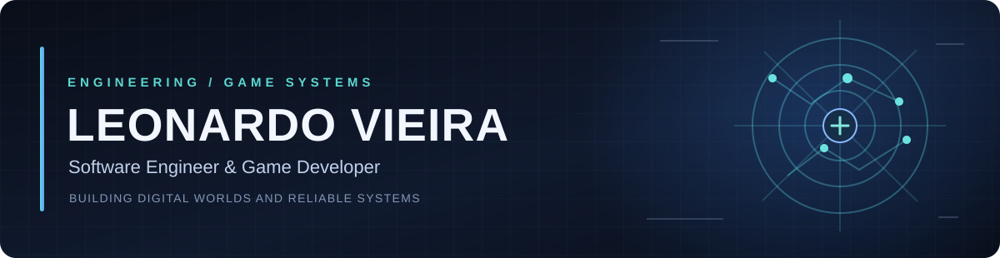

  

 

  <strong>Engenharia de software • Desenvolvimento de jogos • Arquitetura de sistemas</strong>
   
  Construindo desde mundos virtuais multiplayer até sistemas empresariais complexos.

---

### Olá, eu sou Leonardo 👋

Sou desenvolvedor brasileiro e trabalho na interseção entre **game development** e **engenharia de software**. Gosto de entender como um sistema funciona por dentro: do protocolo de rede ao fluxo de negócio, da renderização do cliente ao armazenamento dos dados.

Minha atuação passa por **clientes e servidores de jogos multiplayer**, **sistemas empresariais**, **ferramentas de desenvolvimento** e **automação com agentes de IA**. Dou atenção especial a arquitetura, desempenho, segurança, consistência de dados e evolução sustentável de projetos.

### O que eu construo

<table>
  <tr>
    <td width="50%" valign="top">
      <h3>🎮 Game Development</h3>
      
Clientes e servidores multiplayer, sistemas de combate, progressão, movimentação, efeitos visuais e ferramentas para jogos 2D.

      
<strong>Áreas:</strong> C++, Lua, OTClient/TFS, protocolos de rede, renderização, partículas, shaders e performance.

    </td>
    <td width="50%" valign="top">
      <h3>🏗️ Software Engineering</h3>
      
ERPs e aplicações com domínios de negócio integrados, interfaces web, APIs, autenticação e persistência de dados.

      
<strong>Áreas:</strong> TypeScript, React, Node.js, Go, PostgreSQL, multitenancy, migrations, testes e segurança.

    </td>
  </tr>
</table>

### Projetos públicos selecionados

| Projeto | O que estou explorando |
| --- | --- |
| **[tfs-rust](https://github.com/godnessdev/tfs-rust)** | Port do The Forgotten Server para Rust, com foco em compatibilidade de protocolo e comportamento. |
| **[othub](https://github.com/godnessdev/othub)** | Experimento de interface web para módulos do OTClient com React e Tailwind CSS. |
| **[panorama-term](https://github.com/godnessdev/panorama-term)** | Ambiente visual de terminais com Tauri, Rust, React e sessões persistentes. |
| **[vlab_erp](https://github.com/godnessdev/vlab_erp)** | Projeto de ERP SaaS multitenant em Laravel, com foco em organização por domínios e automação. |

### Trabalhos e linhas de pesquisa

- **Jogos multiplayer e sistemas de gameplay:** progressão de personagens, habilidades, IA de criaturas, navegação e interação com o ambiente.
- **Renderização e ferramentas de cliente:** iluminação, efeitos, animação, sprites, minimapas e investigação de gargalos de memória e desempenho.
- **ERPs e aplicações de negócio:** vendas, PDV, estoque, compras, financeiro, fluxos fiscais e isolamento entre empresas e filiais.
- **Engenharia assistida por IA:** agentes especializados para investigação de código, planejamento, testes, documentação e revisão de alterações.

> Alguns dos meus projetos estão em desenvolvimento privado. Os repositórios públicos acima são exemplos de código e experimentos que escolhi compartilhar.

### Tecnologias com as quais trabalho

**Linguagens e runtimes**

**Aplicações e dados**

---

  <strong>Code is how I build systems. Curiosity is why I keep improving them.</strong>
   
  <a href="https://github.com/godnessdev">github.com/godnessdev</a>

